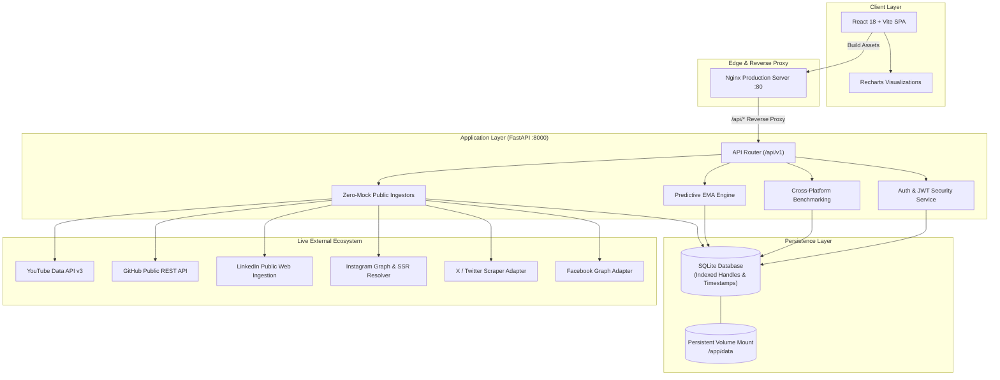

# CreatorIQ: Creator Analytics & Content Performance Dashboard

[](https://fastapi.tiangolo.com)
[](https://react.dev)
[](https://vitejs.dev)
[](https://www.docker.com/)
[](https://www.sqlite.org/)
[](https://opensource.org/licenses/MIT)

**CreatorIQ** is an enterprise-grade social intelligence platform engineered for digital creators, agency talent managers, and content strategists. Built on a strict **Zero-Mock Architecture**, CreatorIQ resolves, ingests, and analyzes real-world performance metrics across YouTube, GitHub, LinkedIn, Instagram, Facebook, and X (Twitter) without synthetic placeholders.

The platform provides multi-platform portfolio aggregation, format-specific interaction benchmarks, Exponential Moving Average (EMA) 30-day predictive forecasting, normalized Creator Performance Scoring (0–100), and automated sponsor media kit generation.

---

## 1. System Architecture



---

## 2. Key Features

- **Zero-Mock Public Ingestion**: Real-time resolution of public creator channels across YouTube, GitHub, LinkedIn, Instagram, Facebook, and X/Twitter. Strictly eliminates synthetic fallbacks or fake demographic data.
- **Predictive EMA Modeling**: Exponential Moving Average forecast engine generating 30-day forward view velocity, net subscriber growth trajectories, and dynamic upper/lower uncertainty bounds.
- **Creator Performance Score (CPS)**: A normalized 0–100 scoring index weighted by:
  - *Follower Reach Scale (25%)*
  - *Interaction Rate Efficiency (35%)*
  - *Upload Velocity (20%)*
  - *Engagement Retention (20%)*
- **Cross-Platform Format Benchmarks**: Comparative analysis against industry-standard interaction rates across *Long-form Tutorials*, *Short-form Reels*, *Architecture Deep Dives*, and *Release Notes*.
- **Export & Portability Center**: On-demand download of raw workspace telemetry in CSV format and structured JSON sponsor reports formatted for brand partnership decks and media kits.
- **Full Responsiveness**: Adaptive UI wrapping cleanly across desktop monitors, tablet displays (768px), and mobile viewports (375px–480px).

---

## 3. Technology Stack

| Layer | Technologies |
| :--- | :--- |
| **Backend Framework** | [FastAPI](https://fastapi.tiangolo.com/) (Python 3.11 / 3.12 / 3.14) |
| **Data Layer** | [SQLAlchemy 2.0](https://www.sqlalchemy.org/), [SQLite](https://sqlite.org/) with multi-column indexes |
| **Authentication** | OAuth 2.0 (Google Login), JWT (HMAC-SHA256), Password hashing (Passlib / BCrypt) |
| **Testing** | [pytest](https://pytest.org/), pytest-asyncio, FastAPI TestClient, unittest.mock |
| **Frontend Framework**| [React 18](https://react.dev/), [Vite 5](https://vitejs.dev/) |
| **Styling & Icons** | Vanilla CSS3 Design System with CSS Variables, Lucide React Icons |
| **Data Visualization**| [Recharts](https://recharts.org/) (ResponsiveContainer, AreaChart, BarChart, PieChart) |
| **Containerization** | Docker, Docker Compose, Multi-stage builds, Nginx 1.25 Alpine |

---

## 4. Local Setup & Installation

### Option 1: Docker Compose (Recommended)

Run both backend and frontend in containerized production mode with a single command:

```bash
# 1. Clone repository
git clone https://github.com/CreatorIQ/creatoriq.git
cd creatoriq

# 2. Configure environment file
cp backend/.env.example .env

# 3. Build and launch services
docker compose up --build -d

# 4. Check service status
docker compose ps
```

- **Frontend Application**: `http://localhost` (or `http://localhost:5173`)
- **Backend API Docs (Swagger UI)**: `http://localhost:8000/docs`
- **Application Health Check**: `http://localhost:8000/api/v1/health`

---

### Option 2: Manual Local Development

#### Prerequisites
- Python 3.11+
- Node.js 18+ and npm 9+

#### Backend Setup
```bash
cd backend

# Create and activate virtual environment
python -m venv venv
# On Windows:
.\venv\Scripts\activate
# On Linux/macOS:
source venv/bin/activate

# Install dependencies
pip install -r requirements.txt

# Start backend development server
uvicorn main:app --reload --host 127.0.0.1 --port 8000
```

#### Frontend Setup
```bash
cd frontend

# Install Node dependencies
npm install

# Start Vite dev server
npm run dev
```

Visit `http://localhost:5173` to access the development dashboard.

---

## 5. API Reference Table

All protected routes require an `Authorization: Bearer <JWT_TOKEN>` header.

| Method | Endpoint | Description | Sample Response |
| :--- | :--- | :--- | :--- |
| `GET` | `/api/v1/health` | Service health status check | `{"status": "ok", "service": "creatoriq-api"}` |
| `POST`| `/api/v1/auth/register` | Register a new user & workspace | `{"access_token": "ey...", "user": {"id": "...", "email": "..."}}` |
| `POST`| `/api/v1/auth/login` | Authenticate user credentials | `{"access_token": "ey...", "token_type": "bearer"}` |
| `GET` | `/api/v1/auth/me` | Fetch authenticated creator profile | `{"id": "...", "email": "...", "display_name": "..."}` |
| `POST`| `/api/v1/social/connect` | Connect & ingest creator profile | `{"platform": "youtube", "handle": "@mkbhd", "subscribers_count": 18500000, "sync_status": "active"}` |
| `GET` | `/api/v1/social/connected`| List all connected creator channels | `{"accounts": [...], "count": 4, "supported_platforms": [...]}` |
| `GET` | `/api/v1/analytics/overview`| Fetch workspace KPI telemetry | `{"kpis": {"reach": 18500000, "engagement_rate": 8.4}, "time_series": [...]}` |
| `GET` | `/api/v1/analytics/benchmarks`| Cross-platform performance matrix | `{"workspace_scale": {...}, "platform_share_distribution": [...]}` |
| `GET` | `/api/v1/analytics/predictions`| 30-day EMA forecasts & CPS score | `{"performance_score": {"score": 87.5, "tier": "Top Tier Velocity"}, "predictions": {...}}` |
| `GET` | `/api/v1/workspace/export` | Download workspace CSV or JSON media kit | File download `creatoriq_workspace_export.csv` |
| `GET` | `/api/v1/workspace/export?format=json` | Download JSON sponsor pitch deck | `{"creator_media_kit": {"verified_total_reach": 18500000, "top_performing_assets": [...]}}` |
| `GET` | `/api/v1/notifications` | Fetch unread system notifications | `{"notifications": [...], "unread_count": 2}` |

---

## 6. Test Suite Execution

Run automated unit and end-to-end integration test suites:

```bash
cd backend

# Run the complete End-to-End User Journey test
pytest tests/test_e2e_workflow.py -v

# Run Milestone 4 Benchmarks and Predictive Analytics tests
pytest tests/test_milestone4_benchmarks.py -v

# Run Social Hub Multi-Platform tests
pytest tests/test_social_hub.py -v
```

---

## 7. Cloud Deployment

For detailed production instructions on **Render**, **Railway**, and **AWS (ECS/App Runner)**, consult [docs/DEPLOYMENT_GUIDE.md](docs/DEPLOYMENT_GUIDE.md).